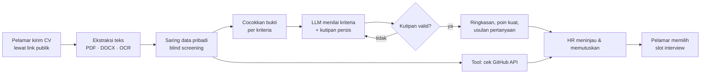

<div align="center">


# Saring

**AI recruitment agent yang menyaring pelamar berdasarkan bukti, bukan tebakan.**

Dibuat untuk GTNIC 2026 · Kategori AI Agent · *Building Intelligent AI Agents for Enterprise Productivity*


</div>

<!-- Tambahkan screenshot dashboard di docs/screenshot.png lalu hapus tanda komentar ini:

-->

## Masalah

Tim HR menghabiskan berjam-jam membaca CV satu per satu untuk tiap lowongan. Penilaian manual lambat, tidak konsisten, dan mudah bias karena nama, foto, atau latar belakang pelamar.

## Solusi

Saring adalah agent yang bekerja sejak lamaran masuk sampai jadwal interview, sementara keputusan tetap di tangan HR.

| | Fitur | Yang dilakukan agent |
|---|---|---|
| 🔗 | **Link lamaran publik** | HR membuat lowongan dan membagikan satu link. Pelamar tidak perlu akun. |
| 🤖 | **Analisis otomatis** | Begitu CV masuk, agent membacanya (PDF/DOCX, OCR untuk hasil scan) dan menilai tiap kriteria lowongan. |
| 🧾 | **Bukti, bukan skor buta** | Setiap penilaian disertai kutipan persis dari CV. Kutipan yang tidak ada di CV ditolak sistem. |
| 🙈 | **Blind screening** | Nama, kontak, foto, agama, dan data pribadi lain disaring sebelum CV dikirim ke model AI. |
| 🛠️ | **Tool calling** | Agent memeriksa link GitHub lewat API resmi (repo, bahasa, aktivitas) sebagai bahan tambahan untuk HR. |
| 🔁 | **Pemulihan otomatis** | Panggilan AI yang gagal dicoba ulang dengan batas aman; CV berbahasa lain ditandai untuk dibaca manual. |
| 💬 | **Usulan pertanyaan interview** | Agent menyusun pertanyaan dari skill yang buktinya paling lemah. |
| 📅 | **Penjadwalan** | HR menyetujui shortlist, pelamar memilih sendiri slot interview yang masih kosong. |
| 👥 | **Akun tim HR** | Admin perusahaan mengundang rekan lewat link; tiap orang membuat password sendiri. |
| ⚙️ | **Pilih model AI** | Gemini, OpenAI, Groq, OpenRouter, atau Ollama; API key disimpan terenkripsi di server. |

> AI tidak pernah menolak atau memilih pelamar secara otomatis. "Belum ada bukti" bukan berarti tidak mampu.

## Cara kerja agent



Detail arsitektur: [docs/ARCHITECTURE.md](docs/ARCHITECTURE.md)

## Tech stack

| Lapisan | Teknologi |
|---|---|
| Frontend | Next.js 16 (App Router), React 19, TypeScript |
| Backend API | FastAPI, SQLAlchemy, Alembic |
| Agent worker | Proses Python terpisah dengan antrean job, lease, dan retry |
| Database | SQLite (lokal) atau PostgreSQL (Docker) |
| AI | LLM OpenAI-compatible: Gemini, OpenAI, Groq, atau Ollama |
| Dokumen | pypdf, python-docx, Tesseract OCR |

## Menjalankan secara lokal (Windows)

Butuh **Python 3.12+** dan **Node.js 22+**.

```powershell
# 1. Install dependensi dan siapkan database
.\setup.cmd

# 2. Buat file konfigurasi, lalu isi SESSION_SECRET dan model AI di env.cmd
Copy-Item env.example.cmd env.cmd

# 3. (Opsional) Isi data demo: 3 lowongan dan 9 pelamar fiktif
.venv\Scripts\python.exe -m backend.seed

# 4. Jalankan API, worker, dan web sekaligus
.\start-all.cmd
```

Buka **http://127.0.0.1:5173**. Akun data demo: `saring@gmail.com` / `saring123456`.

Contoh konfigurasi AI di `env.cmd` (Gemini, punya kuota gratis):

```bat
set OPENAI_API_KEY=api-key-dari-aistudio.google.com
set OPENAI_MODEL=gemini-3.1-flash-lite
set OPENAI_BASE_URL=https://generativelanguage.googleapis.com/v1beta/openai/
```

<details>
<summary>Docker (PostgreSQL)</summary>

```bash
cp .env.example .env   # isi SESSION_SECRET dan model AI
docker compose up --build
```

Buka http://localhost:8080.
</details>

## Struktur project

```
backend/            FastAPI, agent worker, migrasi database, seed data demo
  worker.py         Pipeline agent: ekstraksi → bukti → LLM → insight
  analysis.py       Prompt, validasi kutipan, blind screening
  linkcheck.py      Tool pemeriksa link (GitHub API)
src/app/            Halaman Next.js: dashboard HR, portal pelamar, login
src/lib/            Klien API dan pemetaan data backend ke UI
docs/               Dokumentasi backend, kontrak API, arsitektur, deployment
```

## Keamanan

- Sesi HttpOnly + CSRF, password di-hash dengan Argon2, tanpa token di localStorage.
- API key AI disimpan terenkripsi di server dan tidak pernah dikirim kembali ke browser; hanya platform admin yang bisa mengubah model.
- Anggota tim bergabung lewat link undangan sekali pakai (disimpan sebagai hash, berlaku 7 hari); tidak ada yang mengetik password orang lain.
- File CV disimpan privat dan hanya bisa diunduh HR di organisasi yang sama.

Dokumentasi lengkap backend: [docs/BACKEND.md](docs/BACKEND.md) · Kontrak API: [docs/API_CONTRACT.md](docs/API_CONTRACT.md)

## Tim

| Nama | Peran |
|---|---|
| Evel Sulistyo | AI agent & backend |
| Romeoraffael | Frontend & desain UI |
| Iqbal Ghifari | Integrasi frontend-backend & deployment |
