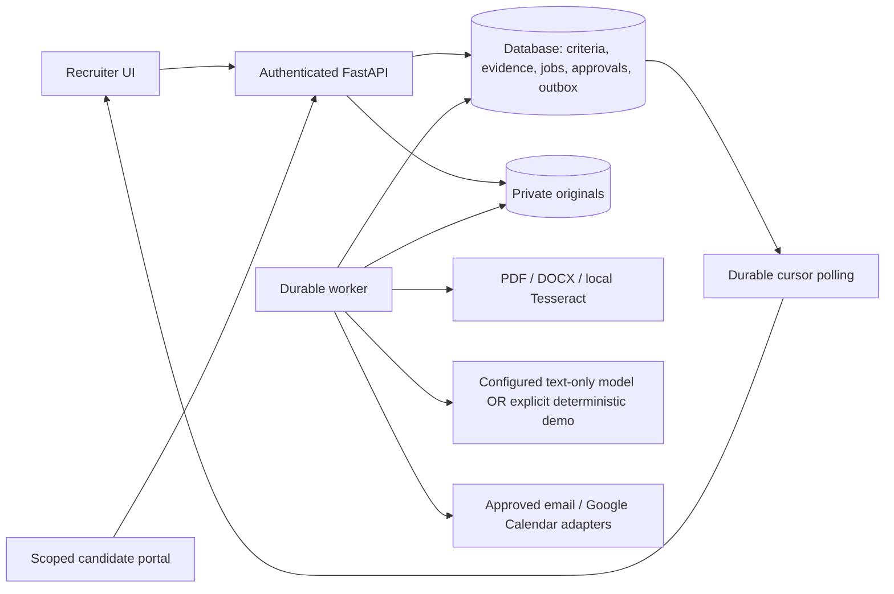

# Architecture and execution contracts

Saring runs as a React/Vite client, FastAPI API, durable Python worker, relational database and private file directory. Browser requests use same-origin HttpOnly sessions and CSRF tokens. The browser polls persisted events; browser timers never advance workflow state. SQLite supports CMD development. PostgreSQL and shared private storage are the intended multi-process deployment components; that runtime has not been integration-tested here.

Vacancy state: `draft → published → closed`. Publication requires an approved immutable requirement version. Edits produce a new version, preserve earlier versions and mark affected reviews for reassessment. Every application retains its criteria identity. Human decisions alone record shortlist/reject/request-more-information/hire; neither model output nor coverage makes a decision.

Per-application progress: ingest → minimize irrelevant fields → associate approved evidence → identify gaps → await recruiter clarification approval → await candidate → update findings → recruiter review → invitation approval → explicit scheduling → booked/needs attention. Batch completion means analysis jobs committed, not that every candidate answered. The UI distinguishes pending clarification approval from later substantive recruiter review.

Execution jobs use queued/running/done/failed/cancelled states with fenced leases, heartbeats and three automatic attempts. Attempt history survives manual retry. HR/candidate waiting states have no active job lease and survive restarts. A candidate submission and its continuation are committed together. External provider actions are transactional outbox records, with queued/running/provider-accepted or simulated/failed/delivery-unknown/disconnected states. Provider idempotency and reconciliation reduce duplicates but do not establish exactly-once delivery.

Tools are scoped application operations, not open-ended model capabilities:

| Tool | Input boundary | Stored result |
|---|---|---|
| PDF/DOCX/OCR | Generated private storage key; bounded file/page/pixel/time limits | Immutable extraction revision and actual page/paragraph references; uncertainty |
| Evidence analysis | Approved requirement plus minimized passages from that application | Validated requirement/evidence IDs, exact quotes, partial/unknown finding, concise explanation; provider/model/prompt/usage metadata |
| Clarification proposal | Authorized evidence, allowed action, three-question/one-round budget | Validated next action and brief operational rationale; no hidden reasoning |
| Candidate submission | Own application, approved questions, scoped expiring invitation, consent | Immutable self-report/artifact presence, idempotent receipt and source-linked revisions |
| Interview brief | Approved criteria and stored evidence | Editable versioned observations, uncertainties, source links and interview questions |
| Email/calendar | Exact recipient/content/policy approval, separate from clarification | Stable action/provider IDs, accepted/unknown/error result; no read/delivered inference |
| Retention | Offline scoped maintenance, withdrawn application and resolved cancellation | Transactional logical erasure plus bounded private-file deletion queue |

External text and CV content are untrusted data. Embedded instructions cannot change criteria, execute tools or grant authority. Portfolios are optional and URL retrieval is disabled: an unavailable/private GitHub link is unverified, never negative evidence; Python repositories do not contradict a Go claim. Sources of excluded documents stay historical but are removed from new automated association; exclusion requires a reason and reassessment.

The public demo provisions a separate synthetic tenant per session. **Explore complete demo** creates five people with ten separate applications across Support and Developer vacancies. Generated DOCX/PDF originals use the real parser; generated scanned PDF uses real local OCR when configured. Model, mail and calendar adapters are explicitly deterministic/simulated, with no live calls. Arbitrary public file uploads are rejected. Demo reset is authenticated, CSRF/rate protected and scoped to its own synthetic tenant; original file cleanup is queued. Sample criteria are explicitly synthetic; custom vacancy criteria always need HR approval.

Details and request schemas: [API contract](../API_CONTRACT.md). Privacy/operational limits and actual test results: [verification report](TEST_REPORT.md).
